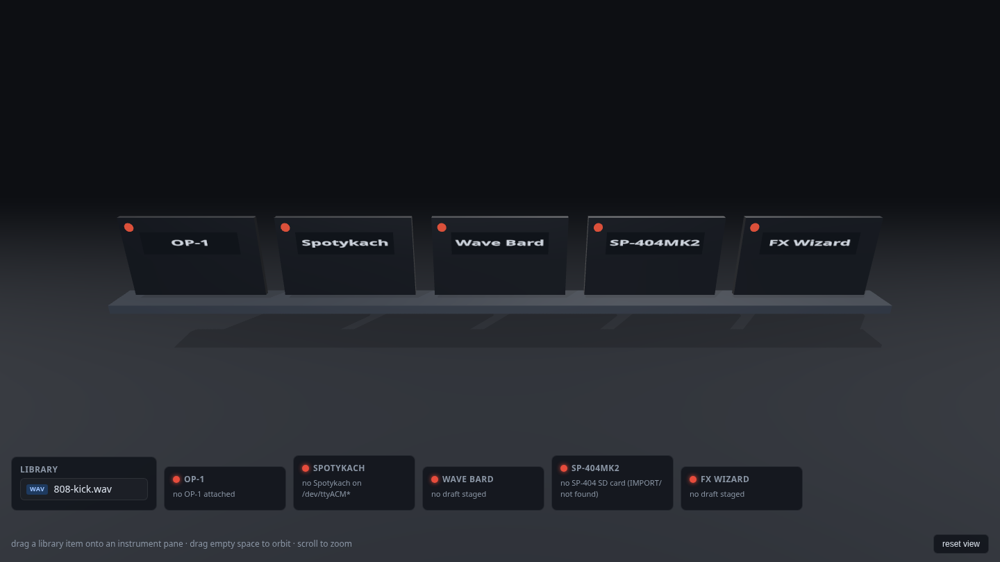

# Sample Hub

> One localhost web interface that moves a sample between every USB instrument
> on the desk, doing the format conversion for each destination so a drop
> always lands in a file the target can actually use.

Status: milestone 10 — sink/source redesign (device tree, source panes,
staged transfers). See SPEC.md for the full contract.

The rack with no instruments attached — every presence dot reads red. Each
instrument is classified sink-only, source-only or sink-source; source devices
(OP-1, SP-404 export dir) list their files, each draggable onto a legal sink.

## Run

    .venv/bin/python -m server --port 8766

Then open http://127.0.0.1:8766/. Loopback only, stdlib only, no build step —
the client is plain ES modules with three.js vendored under `client/vendor/`.

The launcher wires the live hardware: every status poll auto-mounts a visible
but unmounted OP-1 / SD-card / RPI-RP2 volume via `udisksctl` (no sudo), and
each convert resolves its transfer roots from the same probe, so a drop lands
on the device that is actually present now. `SAMPLE_HUB_DATA` moves the
source/staging root (default `~/.sample-hub`).

## Milestone 10: sink/source redesign

Instruments are described by a single JSON tree, `server/devices.json`, which
the server validates and both sides consume. It carries pane order, labels,
the app version / poll cadence / mount-retry interval, and per-device
capabilities: `sink`, `source`, `is_flashable`, and `accepts` (which asset
types a sink will take). Adding a device to the tree is enough to extend the
rack, the conversion matrix, and the client — no other edit needed.

The client has no library pane. Source devices list their content via
`GET /api/devices/<id>/source` and each file is draggable. Drag-and-drop is
legal only between a source and a sink that accepts its type; illegal targets
show a red ✗ and refuse the drop (the server stays authoritative via HTTP 422).
Drops are staged, not sent: each sink lists its pending transfers, and Apply /
Cancel / Undo live in the lower-right bar. Apply commits everything (labelled
"Apply (and flash)" when any staged sink is flashable), Cancel clears all, Undo
removes only the last change.

Flashable Bastl sinks (Wave Bard, FX Wizard) are not drop-and-send targets:
dropping onto one opens a firmware editor overlay (`client/src/editor.js`) that
reproduces the Bastl web loaders — a rhythm editor + sequencer-length selector,
and for Wave Bard a scales editor, a process-samples selector, quality, and
sample banks. Save POSTs the full state to `/api/draft`, which bakes a `.uf2`
draft via `server/pattern.py` (the rhythm/scale bitmask model) and the
per-target writers in `server/devices/`.

## Milestone 9: server + rack client

`server/hub_server.py` is the HTTP layer: `GET /api/health`, `GET /api/status`
(presence dots), `GET /api/devices` (the tree), `GET /api/devices/<id>/source`,
`POST /api/convert` (one transfer = one job), `GET /api/jobs/<id>`, plus static
serving of `client/` with `Cache-Control: no-store`. Jobs are queued one worker
thread per instrument.

`client/` is the front end: a flat shaded rack (`src/scene.js`, geometry in
`src/layout.js`, one number per instrument position in mm), DOM overlay panes
(`src/panes.js`) for each instrument, presence-dot polling on the tree's
`app.poll_ms` cadence (`src/status.js`), legal-only HTML5 drag-and-drop with
staging (`src/dragdrop.js`, `src/staging.js`). The 3D layer is presentation
only; all device I/O stays behind the API.

## Milestone 1: canonical normalizer

`server/library.py` exposes `normalize(src, dst)`: it turns any supported WAV
into the hub's one working form — 48 kHz, stereo, 32-bit IEEE float — the same
shape `wav_builder` already produces for the Spotykach, written with the plain
IEEE-float tag `0x0003` (not `WAVE_FORMAT_EXTENSIBLE`) so the Spotykach
firmware reads it. Every destination transform renders from this copy.

Two properties are pinned by tests:

- stateless / parallel-safe — ffmpeg is NOT a singleton; each `normalize` call
  runs its own subprocess with no shared lock or temp file, so parallel jobs
  (one per instrument) never contend.
- refuses what it cannot decode — a bad source raises `NormalizeError` instead
  of writing a corrupt file.

## Tests

    uv venv --python 3.11      # once
    uv pip install pytest
    .venv/bin/python -m pytest tests/ -q

Tests generate their source WAVs with ffmpeg and decode the normalized bytes
back, so every assertion runs against real bytes, never a mock. Client-shell
tests serve the real `client/` directory and assert the assets are served with
`no-store`, that every module import is relative and resolves (no CDN), that
each source module parses as an ES module, and that the client derives its
rack from `/api/devices` rather than a hardcoded list.

Real-device tests are gated off by default. Tests that talk to a physical USB
instrument are marked `@pytest.mark.real_devices` and only run when you opt in:

    .venv/bin/python -m pytest tests/ --real-devices

## Layout

    server/hub_server.py   HTTP layer (milestone 9c)
    server/__main__.py     launcher: python -m server (milestone 9d)
    server/devices.json    the device tree: order, labels, capabilities (10)
    server/device_tree.py  validated loader + typed views of devices.json (10)
    server/sources.py      source-device listing + read-back (10)
    server/library.py      host cache + canonical normalizer (milestones 1, 9a)
    server/convert.py      conversion matrix, one fn per target
    server/devices/        per-target writers (op1, spotykach, wave_bard, ...)
    server/jobs.py         convert dispatch + per-instrument job queue (9b)
    server/status.py       per-instrument presence probe (milestone 8)
    server/pattern.py      rhythm/scale bitmask model + Bastl validation (10)
    client/                three.js rack client, no build step (milestones 9d, 10)
    SPEC.md                the contract this is built against
